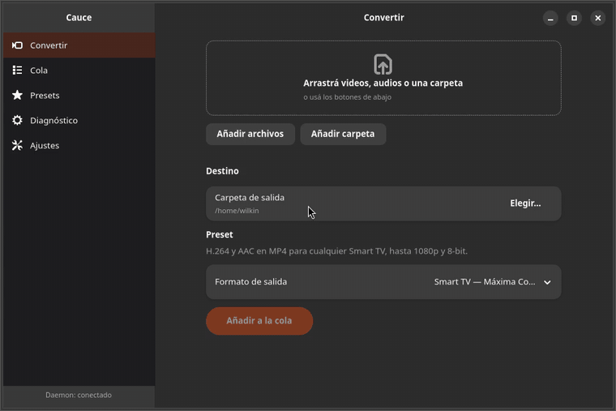
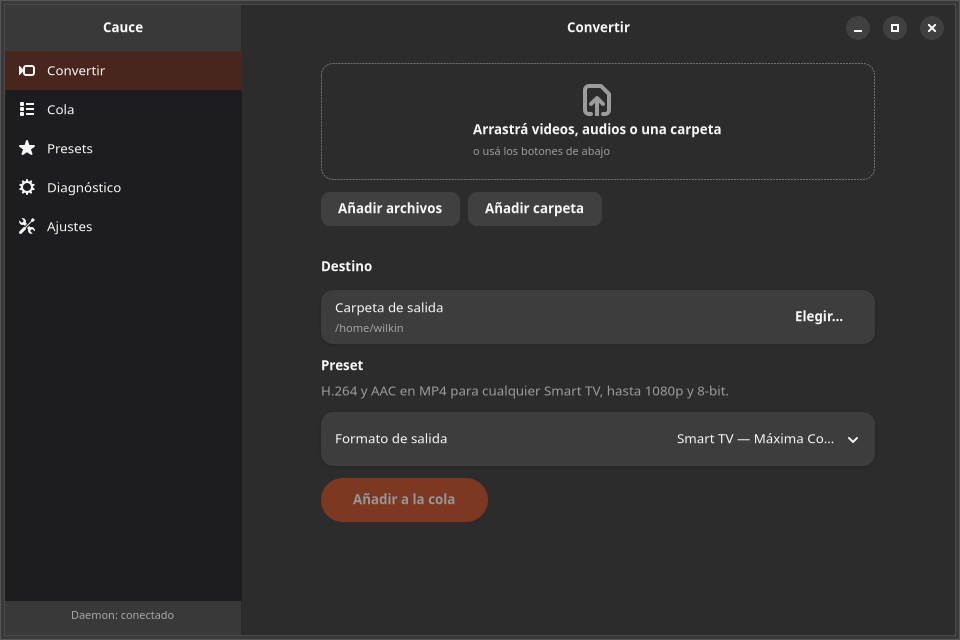
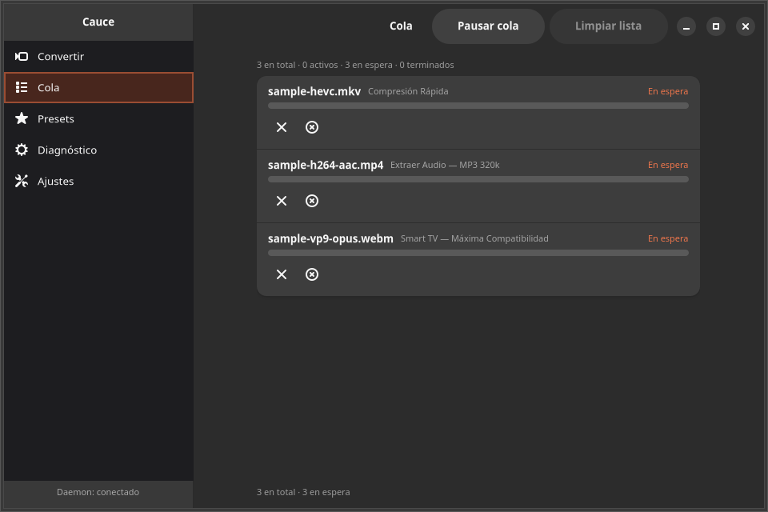
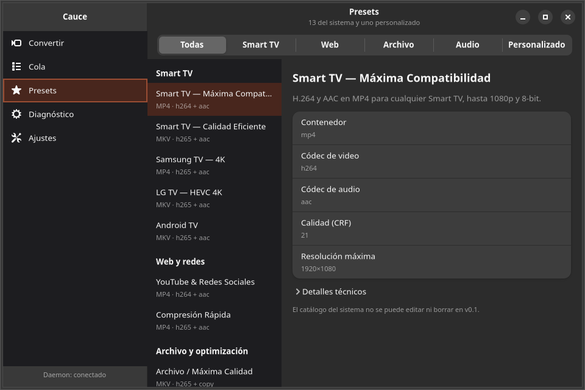
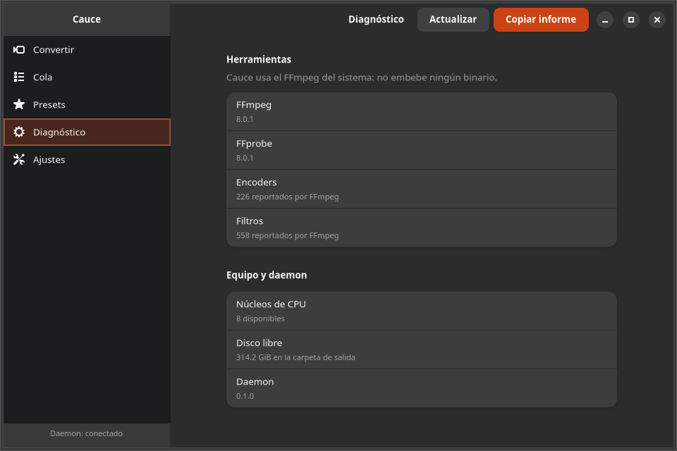
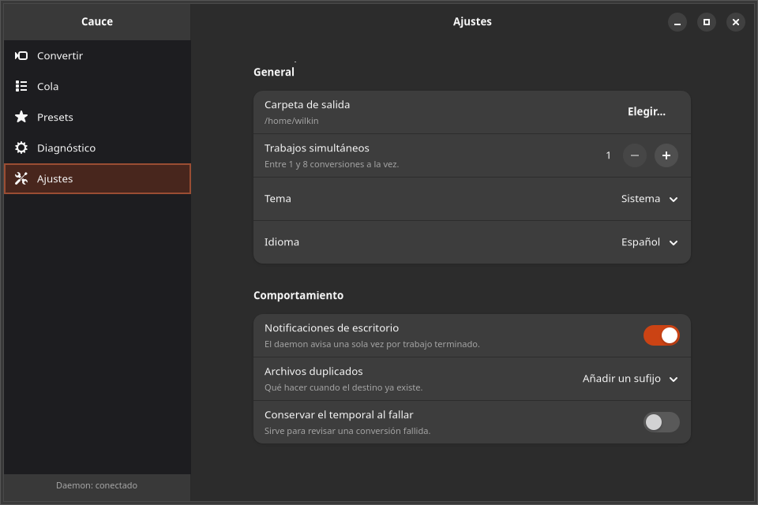

<p align="center">
  
</p>

# Cauce

**Conversor multimedia nativo para Ubuntu 26.04 LTS: FFmpeg del sistema, daemon persistente, presets optimizados y GUI moderna en GTK4 + Libadwaita.**

Cauce es un orquestador y conversor de audio y video por lotes construido en **Rust**. Separa la ejecución de la interfaz: un daemon de usuario administra las conversiones sobre SQLite WAL, mientras que la interfaz gráfica en GTK4 ofrece una experiencia limpia, fluida y nativa en el escritorio GNOME. Si cerrás la ventana, la cola de conversión sigue trabajando en segundo plano sin interrupciones.

[](https://github.com/wilkin-barban/Cauce/actions)
[](LICENSE)
[](https://ubuntu.com)
[](https://www.rust-lang.org)

[Características](#características) · [Capturas](#capturas) · [Presets](#catálogo-de-presets) · [Arquitectura](#arquitectura) · [Instalación](#instalación) · [Estructura del Workspace](#estructura-del-código)

---

<p align="center">
  
</p>

---

## Características principales

- **Daemon desacoplado**: La cola de conversión corre como servicio del usuario (`systemd`). Podés cerrar la interfaz gráfica, reiniciar la sesión o apagar la pantalla: los trabajos en curso continúan sin riesgo de corrupción.
- **FFmpeg del sistema**: No embebe binarios inflados. Aprovecha el `ffmpeg` y `ffprobe` instalados en el sistema operativo, garantizando actualizaciones de seguridad inmediatas y soporte nativo para los códecs de tu distribución.
- **Persistencia duradera con SQLite WAL**: Cada trabajo, progreso medido y evento se persiste transaccionalmente. Ante un reinicio forzado del sistema, las tareas pendientes quedan marcadas para recuperación segura.
- **Progreso y telemetría en tiempo real**: Monitoreo de porcentaje exacto, tiempo procesado, velocidad de codificación, FPS reales y tiempo restante (ETA).
- **13 Presets de fábrica**: Perfiles calibrados para Smart TVs (H.264 / H.265 / 4K), YouTube y redes sociales, compresión rápida, archivo sin pérdida y extracción de audio (MP3 320k, FLAC, ALAC, WAV).
- **Interfaz nativa en Libadwaita**: Diseñada siguiendo las pautas de diseño de GNOME, con soporte completo para modo claro/oscuro del sistema, atajos de teclado y drag & drop de archivos y carpetas.
- **Internacionalización**: Interfaz y descripciones de presets completamente traducidas al Español, Inglés y Portugués de Brasil (PT-BR).

---

## Capturas

| Convertir (Drag & Drop y Presets) | Cola de Conversión Activa |
|:---:|:---:|
|  |  |

| Catálogo de Presets con Detalles | Diagnóstico del Sistema y FFmpeg |
|:---:|:---:|
|  |  |

<p align="center">
  <b>Ajustes del Sistema (Concurrencia, Idioma, Tema y Políticas de Duplicados)</b><br>
  
</p>

---

## Catálogo de Presets

Cauce incluye 13 presets inmutables calibrados según el estándar de la industria:

| Preset | Contenedor | Video | Audio | Calidad (CRF) / Bitrate | Caso de uso principal |
|---|:---:|:---:|:---:|:---:|---|
| **Smart TV — Máxima Compatibilidad** | `mp4` | H.264 | AAC | CRF 21 / 192 kbps | Compatibilidad universal con cualquier televisor o reproductor (1080p, 8-bit). |
| **Smart TV — Calidad Eficiente** | `mkv` | H.265 | AAC | CRF 24 / 324 kbps | Alta eficiencia de compresión en 4K/1080p con preservación de HDR y subtítulos. |
| **Samsung TV — 4K** | `mp4` | H.265 | AAC | CRF 22 / 256 kbps | Optimizado para televisores Samsung 4K HDR con audio de 6 canales y faststart. |
| **LG TV — HEVC 4K** | `mkv` | H.265 | AAC | CRF 22 / 256 kbps | Perfil Matroska con soporte completo para subtítulos flotantes y audio 5.1. |
| **Android TV / Google TV** | `mkv` | H.265 | AAC | CRF 23 / 256 kbps | Reproducción optimizada para dispositivos Android TV y Chromecast. |
| **YouTube & Redes Sociales** | `mp4` | H.264 | AAC | CRF 18 / 320 kbps | Perfil High con `faststart`, espacio de color estándar y compresión óptima para subida. |
| **Compresión Rápida** | `mp4` | H.265 | AAC | CRF 26 / 160 kbps | Reducción agresiva de tamaño de archivo conservando excelente nitidez visual. |
| **Archivo / Máxima Calidad** | `mkv` | H.265 | Copy | CRF 18 / Original | Preserva el audio de origen intacto y recodifica video con máxima fidelidad. |
| **Extraer Audio — MP3 320k** | `mp3` | *none* | MP3 | 320 kbps CBR | Extracción de audio en máxima calidad MP3 conservando metadatos del archivo. |
| **Extraer Audio — FLAC** | `flac` | *none* | FLAC | Lossless | Extracción sin pérdida de calidad de pistas musicales o conciertos. |
| **Extraer Audio — ALAC** | `m4a` | *none* | ALAC | Lossless | Formato Apple Lossless en contenedor M4A para ecosistema Apple. |
| **Extraer Audio — WAV PCM** | `wav` | *none* | PCM 16b | Sin compresión | Audio sin comprimir para edición en DAWs o herramientas de producción. |
| **Exportación Apple Music** | `m4a` | *none* | AAC | 256 kbps | Calidad estándar compatible con dispositivos Apple y bibliotecas locales. |

---

## Arquitectura

Cauce implementa un modelo cliente-servidor local completamente desacoplado:

```text
┌────────────────────────────────────────────────────────┐
│                      cauce-gui                         │
│            (GTK4 + Libadwaita / Desktop)               │
└──────────────────────────┬─────────────────────────────┘
                           │ IPC: JSON-RPC 2.0 (NDJSON)
                           ▼ sobre Unix Domain Socket
┌────────────────────────────────────────────────────────┐
│                     cauce-daemon                       │
│     (Planificador de Jobs / Supervisor de Procesos)    │
├──────────────────────────┬─────────────────────────────┤
│      SQLite 3 (WAL)      │      FFmpeg / FFprobe       │
│  (Persistencia de cola)  │    (Llamadas al sistema)    │
└──────────────────────────┴─────────────────────────────┘
```

1. **`cauce-gui`**: Cliente puramente reactivo. No maneja archivos directamente ni llama a FFmpeg: consulta el estado mediante JSON-RPC y renderiza la cola en tiempo real.
2. **`cauce-daemon`**: Proceso supervisor ejecutado como servicio de usuario (`cauce.service` / `cauce.socket`). Gestiona la concurrencia (1 a 8 procesos paralelos), calcula planes de conversión, captura stdout/stderr de FFmpeg para calcular la telemetría y publica los archivos finales atómicamente evitando colisiones.
3. **Seguridad y Rutas**: El daemon valida las rutas contra raíces autorizadas (`$HOME`), impidiendo la ejecución o sobreescritura accidental fuera de carpetas legítimas del usuario.

---

## Instalación

### Requisitos previos
- **Ubuntu 26.04 LTS** (o distribuciones basadas en Debian con GNOME 45+)
- `ffmpeg` y `ffprobe` (versión 6.0 o superior)

```bash
sudo apt update
sudo apt install ffmpeg
```

### Instalación mediante paquete .deb
Descargá la última versión desde la sección de [Releases](https://github.com/wilkin-barban/Cauce/releases):

```bash
sudo dpkg -i cauce_0.2.0_amd64.deb
```

Habilitá e iniciá el servicio del daemon en tu sesión de usuario:

```bash
systemctl --user enable --now cauce.socket
```

---

## Estructura del código

El proyecto está organizado como un workspace modular en Rust:

```text
crates/
├── cauce-core        # Tipos de dominio, definiciones de Jobs, Presets y errores IPC
├── cauce-daemon      # Servicio background, IPC Unix Socket, planificador y base SQLite
├── cauce-gui         # Interfaz gráfica en GTK4 + Libadwaita (AdwApplicationWindow)
├── cauce-ffmpeg      # Constructor de argumentos FFmpeg, probes y parsers de progreso
├── cauce-jobs        # Máquina de estados de la cola y validación de archivos de salida
├── cauce-i18n        # Sistema de localización reactivo (Español, Inglés, Portugués)
└── cauce-cli         # Herramienta de línea de comandos para diagnóstico interno
```

### Compilación desde el código fuente

```bash
git clone https://github.com/wilkin-barban/Cauce.git
cd Cauce
cargo build --release
```

Los binarios resultantes estarán en `target/release/` (`cauce-daemon` y `cauce-gui`).

---

## Licencia

Distribuido bajo la licencia **GNU General Public License v3.0 or later (GPL-3.0-or-later)**. Consultá el archivo [LICENSE](LICENSE) para más detalles.

Desarrollado por **[Wilkin Barban Rosabal](https://github.com/wilkin-barban)**.
