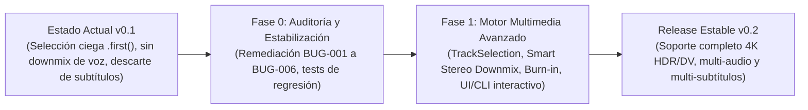
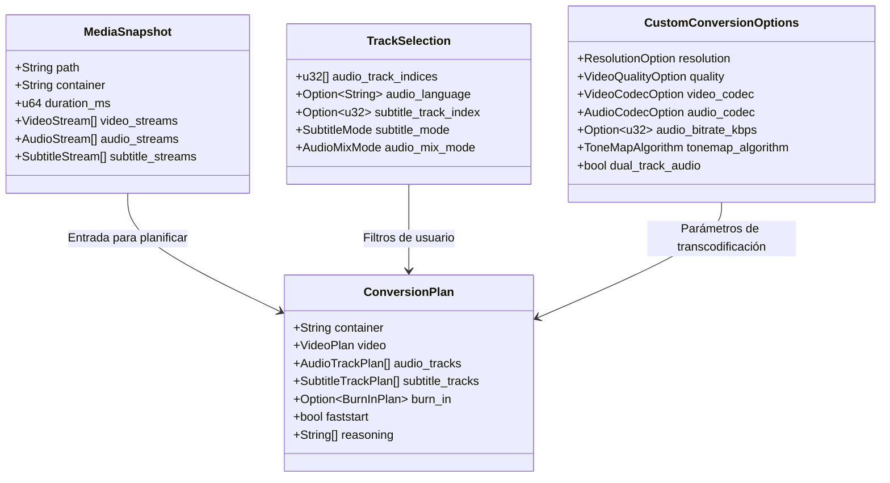
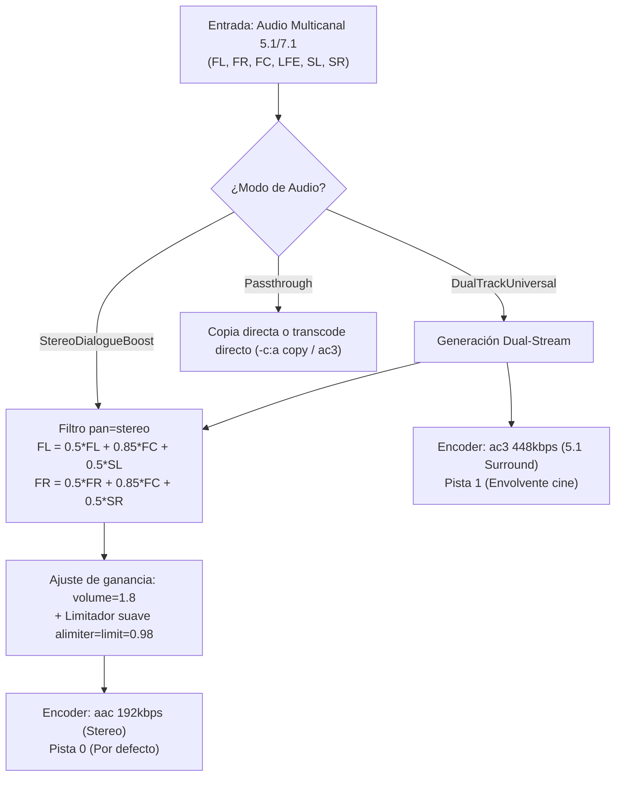

# Cauce — Arquitectura de Evolución Técnica: Fase 0 y Fase 1

**Estado:** Borrador normativo de arquitectura para desarrollo  
**Versión:** 0.2-draft  
**Fecha:** 2026-11-23  
**Ámbito:** `cauce-core`, `cauce-ffmpeg`, `cauce-jobs`, `cauce-daemon`, `cauce-gui`, `cauce-cli`  
**Documentos relacionados:** [`architecture.md`](file:///home/wilkin/proyectos/Cauce/docs/architecture.md), [`contracts.md`](file:///home/wilkin/proyectos/Cauce/docs/contracts.md), [`data-model.md`](file:///home/wilkin/proyectos/Cauce/docs/data-model.md), [`presets.md`](file:///home/wilkin/proyectos/Cauce/docs/presets.md), [`ui-mvp.md`](file:///home/wilkin/proyectos/Cauce/docs/ui-mvp.md), [`backlog.md`](file:///home/wilkin/proyectos/Cauce/docs/backlog.md)

---

## 1. Resumen Ejecutivo y Visión General

Este documento establece el diseño arquitectónico y el plan técnico director para modernizar **Cauce**, transformándolo de un conversor MVP de selección fija en una plataforma de transcodificación multimedia avanzada, robusta y con control interactivo sobre pistas y perfiles de calidad.

El plan se divide en dos fases secuenciales y no negociables:



### 1.1 Objetivos por Fase

| Fase | Enfoque Principal | Entregable Clave | Criterio de Éxito |
|---|---|---|---|
| **Fase 0** | **Búsqueda de Bugs, Auditoría y Remediación** | Parches quirúrgicos a `cauce-core` y `cauce-ffmpeg` sin romper contratos | Eliminación del bug de audio mudo (diálogos perdidos), eliminación de la falacia `.first()`, soporte de filtros de audio y reporte fiel de fallos. |
| **Fase 1** | **Conversión Avanzada y Selección de Pistas** | Evolución del contrato IPC, selector de pistas de audio y subtítulos, opciones personalizadas de calidad/resolución en GUI y CLI | Capacidad de convertir archivos complejos como *The End of Oak Street* (4K HDR10+/DV, 6 audios, 36 subtítulos) eligiendo idioma exacto, subtítulos deseados y volumen vocal optimizado. |

### 1.2 Archivo de Referencia y Benchmark

Todas las decisiones de diseño, algoritmos de downmix y pruebas de estrés toman como estándar empírico el archivo:
- **Ruta:** `/home/wilkin/Downloads/The.End.Of.Oak.Street.2026.2160p.WEB-DL.DV.HDR10+.MULTi[Ben The Men].mkv`
- **Características:** 22.6 GB, Video HEVC 4K Main 10 (Dolby Vision Profile 8.1 + HDR10+), 6 pistas de audio multicanal (E-AC-3 JOC 5.1 en Inglés, Español Latino, Francés, Alemán, Italiano, Japonés) y 36 pistas de subtítulos (SRT y PGS).

---

## 2. Fase 0 — Auditoría de Bugs y Remediaciones Críticas

Durante la auditoría exhaustiva de la base de código de Cauce v0.1 (`cauce-core`, `cauce-ffmpeg`, `cauce-daemon`, `cauce-gui`), se identificaron seis defectos críticos que impiden la conversión correcta de contenido audiovisual moderno o degradan severamente la experiencia de usuario.

### BUG-001 (CRÍTICO): Pérdida del canal central de diálogos ("Película Muda") en Downmix 5.1 a Estéreo

> [!CAUTION]
> **Severidad:** Crítica (Afecta directamente la usabilidad del medio producido).  
> **Ubicación:** [`crates/cauce-core/src/command.rs`](file:///home/wilkin/proyectos/Cauce/crates/cauce-core/src/command.rs#L78-L83), [`crates/cauce-core/src/command.rs`](file:///home/wilkin/proyectos/Cauce/crates/cauce-core/src/command.rs#L274-L277), [`crates/cauce-core/src/compat.rs`](file:///home/wilkin/proyectos/Cauce/crates/cauce-core/src/compat.rs#L315-L333).

#### Diagnóstico y Causa Raíz
1. Cuando un preset solicita transcodificación de audio a estéreo (`channels = 2`, como en `system-smarttv-compat` o `system-fast-compress`), `push_audio` en `command.rs` inyecta únicamente el argumento `-ac 2`.
2. Si el preset no especifica canales (o permite multicanal) y se empaqueta en MP4 con códec AAC (`-c:a aac`), FFmpeg genera una pista AAC con disposición 5.1(side) utilizando elementos PCE (*Program Configuration Element*). En el contenedor MP4 estándar, esta disposición se marca internamente como diseño de canales desconocido (`channel_layout=unknown`).
3. Al reproducirse en sistemas Linux modernos (servidores PipeWire / PulseAudio / ALSA) o en dispositivos de 2 canales (laptops, teléfonos, auriculares), el motor de audio no reconoce el mapeo del PCE y descarta o atenúa severamente el canal central (`FC` - *Front Center*). Dado que en el cine y las series el 100% de los diálogos se mezclan en el canal central, el resultado es una **"película muda"**: se escuchan efectos ambientales y música de fondo lejana, pero las voces humanas desaparecen.
4. Para empeorar la situación, `crates/cauce-core/src/command.rs` en sus líneas 78-83 prohíbe explícitamente cualquier filtro de audio:
   ```rust
   if plan.audio.normalize {
       return Err(invalid(
           "audio normalization is not part of the v0.1 filter allowlist; refusing to ignore `normalize`",
       ));
   }
   ```
   Cauce v0.1 no tiene ninguna vía para inyectar `-af` o filtros de audio, impidiendo cualquier corrección matemática de canales.

#### Remediación en Fase 0
1. **Habilitar cadena de filtros de audio (`audio_filter_chain`)**:
   Implementar en `command.rs` la función `audio_filter_chain(&AudioPlan) -> Option<String>` e inyectar el flag `-af` (o `-filter:a`) en la llamada a FFmpeg.
2. **Matriz de downmix estéreo con realce vocal obligatorio**:
   Cuando la fuente tenga $\ge 6$ canales (5.1, 7.1) y el destino sea estéreo (2 canales), se debe aplicar una matriz de mezcla ponderada que sume el canal central a los canales izquierdo y derecho con ganancia prioritaria:
   $$\text{FL} = 0.5 \times \text{FL} + 0.85 \times \text{FC} + 0.5 \times \text{SL}$$
   $$\text{FR} = 0.5 \times \text{FR} + 0.85 \times \text{FC} + 0.5 \times \text{SR}$$
   Sintaxis FFmpeg requerida:
   ```text
   -af "pan=stereo|FL=0.5*FL+0.85*FC+0.5*SL|FR=0.5*FR+0.85*FC+0.5*SR,volume=1.8"
   ```
   Esto asegura que en parlantes estéreo los diálogos se escuchen nítidos, claros y con presencia adecuada, eliminando completamente el bug de la película muda.

---

### BUG-002 (CRÍTICO): Falacia de selección ciega `.first()` e ignorancia de pistas de idioma

> [!WARNING]
> **Severidad:** Crítica (Pérdida de datos e imposibilidad de seleccionar idioma).  
> **Ubicación:** [`crates/cauce-core/src/compat.rs`](file:///home/wilkin/proyectos/Cauce/crates/cauce-core/src/compat.rs#L262), [`crates/cauce-core/src/compat.rs`](file:///home/wilkin/proyectos/Cauce/crates/cauce-core/src/compat.rs#L362).

#### Diagnóstico y Causa Raíz
En `crates/cauce-core/src/compat.rs`:
```rust
fn plan_audio(snapshot: &MediaSnapshot, preset: &Preset, reasoning: &mut Vec<String>) -> AudioPlan {
    // ...
    let Some(stream) = snapshot.audio_streams.first() else { ... };
    // ...
}

fn plan_subtitles(snapshot: &MediaSnapshot, preset: &Preset, reasoning: &mut Vec<String>) -> Result<SubtitlePlan, JobError> {
    let Some(first) = snapshot.subtitle_streams.first() else { ... };
    // ...
}
```
1. `plan_audio` y `plan_subtitles` toman de manera ciega e incondicional el primer elemento del vector (`.first()`).
2. En archivos MKV internacionales con múltiples idiomas (e.g. Oak Street con 6 pistas de audio), la pista 0 suele ser la versión original en inglés. Si un usuario hispanohablante procesa la película, Cauce convierte forzosamente el audio en inglés y **descarta todas las demás pistas sin avisar ni permitir selección**.
3. A pesar de que `Preset` define el campo `preferred_audio_language: Option<String>` en [`crates/cauce-core/src/preset.rs`](file:///home/wilkin/proyectos/Cauce/crates/cauce-core/src/preset.rs) y en [`docs/presets.md`](file:///home/wilkin/proyectos/Cauce/docs/presets.md#L69), `compat.rs` **nunca consulta este campo** (cero menciones en todo el archivo).

#### Remediación en Fase 0
1. Modificar `plan_audio` para implementar un algoritmo de selección por prioridad:
   - **Prioridad 1:** Coincidencia de idioma con `preset.preferred_audio_language` (comparando códigos ISO 639-1 / 639-2: `es`, `spa`, `es-419`, `en`, `eng`).
   - **Prioridad 2:** Pista marcada con `is_default == true`.
   - **Prioridad 3:** Primera pista de audio disponible (`.first()`).
2. Reflejar en el campo `reasoning` del plan la pista seleccionada, su índice de entrada, idioma y cantidad de canales.

---

### BUG-003 (ALTO): Descarte destructivo de subtítulos en MP4 y subtítulos bitmap (PGS)

> [!NOTE]
> **Severidad:** Alta (Incompatibilidad de subtítulos e interrupción de trabajos).  
> **Ubicación:** [`crates/cauce-core/src/compat.rs`](file:///home/wilkin/proyectos/Cauce/crates/cauce-core/src/compat.rs#L405-L433), [`crates/cauce-core/src/command.rs`](file:///home/wilkin/proyectos/Cauce/crates/cauce-core/src/command.rs#L294-L298).

#### Diagnóstico y Causa Raíz
1. Los subtítulos en formato PGS (`hdmv_pgs_subtitle`), comunes en ripeos de Blu-ray y WEB-DL 4K, son secuencias de mapas de bits (imágenes).
2. Cauce v0.1 descarta automáticamente cualquier subtítulo bitmap en contenedores MP4 mediante `removed_bitmap_subtitles()`. Si el preset requiere subtítulos (`subtitle_policy: BurnIn`), el command builder aborta con error:
   ```rust
   SubtitleAction::BurnIn => {
       return Err(invalid("subtitle burn-in has no filter in the v0.1 allowlist"));
   }
   ```
3. Para subtítulos de texto (`subrip` / SRT o ASS), el empaquetado en MP4 exige el códec `mov_text`. Cauce v0.1 mapea `-c:s mov_text`, pero si un estilo complejo de ASS o caracteres especiales no son sanitizados, FFmpeg aborta la ejecución (`PROCESS_FAILED`).

#### Remediación en Fase 0
1. Documentar explícitamente en el plan cuando un subtítulo no es compatible con el contenedor destino y no se puede realizar *burn-in* en CPU sin autorización.
2. Sanitizar la transcodificación de texto plano a `mov_text` en MP4.
3. Asegurar que una falla en la pista de subtítulos no corrompa el proceso de transcodificación de video/audio.

---

### BUG-004 (MEDIO): Validador de salida `output.rs` solo verifica la primera pista

> [!NOTE]
> **Severidad:** Media (Riesgo de falsos positivos en validación post-conversión).  
> **Ubicación:** [`crates/cauce-core/src/output.rs`](file:///home/wilkin/proyectos/Cauce/crates/cauce-core/src/output.rs#L187), [`crates/cauce-core/src/output.rs`](file:///home/wilkin/proyectos/Cauce/crates/cauce-core/src/output.rs#L204).

#### Diagnóstico y Causa Raíz
En `crates/cauce-core/src/output.rs`:
```rust
let actual = output.audio_streams.first().map(|stream| stream.codec.as_str());
```
El validador de integridad post-conversión `validate_output` compara el códec de salida esperado contra `output.audio_streams.first()`. Si un trabajo genera múltiples pistas de audio (por ejemplo, una pista estéreo para compatibilidad universal y una pista 5.1 AC-3 envolvente), el validador ignora las pistas secundarias y no verifica si el número de pistas coincide con lo planificado.

#### Remediación en Fase 0
Refactorizar `validate_output` para validar que el conjunto de pistas del archivo resultante coincida en cantidad y tipo con las pistas declaradas en el plan de conversión.

---

### BUG-005 (MEDIO): Fragilidad en Tone Mapping HDR→SDR por dependencia rígida de `zscale`

> [!NOTE]
> **Severidad:** Media (Fallo de ejecución en entornos sin `libzimg`).  
> **Ubicación:** [`crates/cauce-core/src/command.rs`](file:///home/wilkin/proyectos/Cauce/crates/cauce-core/src/command.rs#L313-L316).

#### Diagnóstico y Causa Raíz
La función `tonemap_filter_chain()` genera:
```text
zscale=t=linear:npl=100,format=gbrpf32le,zscale=p=bt709,tonemap=tonemap=hable:desat=0,zscale=t=bt709:m=bt709:r=tv
```
Si el binario de FFmpeg del sistema operativo no fue compilado con soporte para la biblioteca `libzimg`, el filtro `zscale` no está disponible. FFmpeg termina inmediatamente con código de error, provocando un fallo no recuperable del trabajo.

#### Remediación en Fase 0
1. Comprobar en `cauce-ffmpeg/toolchain.rs` si el filtro `zscale` está reportado en `Capabilities.filters`.
2. Si `zscale` no está presente, utilizar como fallback el filtro nativo de mapeo de tonos de FFmpeg:
   ```text
   tonemap=mobius,format=yuv420p
   ```
   evitando que el trabajo se interrumpa en instalaciones estándar de FFmpeg.

---

### BUG-006 (MEDIO): Archivos temporales huérfanos tras corte abrupto del daemon

> [!NOTE]
> **Severidad:** Media (Consumo descontrolado de almacenamiento en disco).  
> **Ubicación:** [`crates/cauce-jobs/src/`](file:///home/wilkin/proyectos/Cauce/crates/cauce-jobs/src/), [`crates/cauce-daemon/src/main.rs`](file:///home/wilkin/proyectos/Cauce/crates/cauce-daemon/src/main.rs).

#### Diagnóstico y Causa Raíz
Durante conversiones pesadas (como archivos 4K de 20 GB), el daemon crea un archivo temporal `.cauce-<job_id>.part.<ext>`. Si el sistema operativo se reinicia o el proceso del daemon se cierra inesperadamente, al reiniciar el daemon marca el trabajo como `interrupted`, pero el archivo temporal queda huérfano en el directorio de salida sin que exista un mecanismo de limpieza o recolección de basura.

#### Remediación en Fase 0
Incorporar en la rutina de inicio de `cauce-daemon` un reconciliador de almacenamiento que identifique archivos temporales `.cauce-*.part.*` asociados a trabajos en estado `interrupted` o `failed` y proporcione una política clara de purga o recuperación.

---

## 3. Fase 1 — Arquitectura del Motor Multimedia Avanzado

La Fase 1 expande el dominio de Cauce para permitir la transcodificación interactiva y avanzada. Se diseñan nuevos contratos, estructuras de datos y componentes visuales que otorgan al usuario control total sobre pistas de audio, subtítulos, resolución y calidad.

### 3.1 Modelo de Dominio Extendido (`cauce-core`)



#### 3.1.1 Nuevas Estructuras en `cauce-core/src/plan.rs`

```rust
/// Opciones de selección explícita de pistas por parte del usuario o preset.
#[derive(Debug, Clone, PartialEq, Serialize, Deserialize)]
pub struct TrackSelection {
    /// Índices de pistas de audio de entrada a procesar (en orden de inclusión).
    pub audio_track_indices: Vec<u32>,
    /// Pista de subtítulo elegida para incluir o incrustar.
    pub subtitle_track_index: Option<u32>,
    /// Modo de operación para los subtítulos seleccionados.
    pub subtitle_mode: SubtitleMode,
    /// Modo de mezcla y procesamiento de canales de audio.
    pub audio_mix_mode: AudioMixMode,
}

#[derive(Debug, Clone, Copy, PartialEq, Eq, Serialize, Deserialize)]
#[serde(rename_all = "snake_case")]
pub enum SubtitleMode {
    /// Empaquetar como pista suave conmutable (soft subtitle: mov_text en MP4, srt/ass en MKV).
    SoftEmbed,
    /// Quemar permanentemente en los fotogramas del video (hardcode/burn-in).
    BurnIn,
    /// Exportar a archivo complementario externo (.srt).
    ExternalFile,
    /// Omitir subtítulos.
    Strip,
}

#[derive(Debug, Clone, Copy, PartialEq, Eq, Serialize, Deserialize)]
#[serde(rename_all = "snake_case")]
pub enum AudioMixMode {
    /// Copia directa o transcodificación preservando canales originales.
    Passthrough,
    /// Downmix estéreo con matriz de realce de voz (anti-película muda).
    StereoDialogueBoost,
    /// Doble pista: Pista 1 estéreo con realce de voz + Pista 2 envolvente 5.1 original/AC-3.
    DualTrackUniversal,
}

/// Plan individual para una pista de audio de salida.
#[derive(Debug, Clone, PartialEq, Serialize, Deserialize)]
pub struct AudioTrackPlan {
    pub source_index: u32,
    pub output_index: u32,
    pub action: StreamAction,
    pub encoder: Option<String>,
    pub bitrate: Option<String>,
    pub channels: u8,
    pub filter: Option<String>,
    pub language: Option<String>,
    pub title: Option<String>,
    pub is_default: bool,
}

/// Parámetros personalizados que el usuario puede sobrescribir en la GUI o CLI.
#[derive(Debug, Clone, PartialEq, Serialize, Deserialize)]
pub struct CustomConversionOptions {
    pub resolution: ResolutionTarget,
    pub crf: Option<u8>,
    pub video_bitrate_kbps: Option<u32>,
    pub video_codec: Option<String>,
    pub audio_codec: Option<String>,
    pub audio_bitrate_kbps: Option<u32>,
    pub tone_mapping: ToneMappingOption,
}

#[derive(Debug, Clone, PartialEq, Serialize, Deserialize)]
pub enum ResolutionTarget {
    Original,
    Fixed { width: u32, height: u32 },
    MaxHeight(u32), // e.g. 1080p -> max_height = 1080 manteniendo aspect ratio
}
```

---

### 3.2 Motor de Audio: Algoritmo Anti-Audio Mudo (Smart Dialogue Downmix)

Para resolver definitivamente el problema de audio mudo observado en *The End of Oak Street*, Cauce implementa un procesador acústico determinista en `cauce-core`:



#### Especificación de Filtros FFmpeg
1. **Pista Estéreo con Diálogos Mejorados:**
   ```text
   -filter:a:0 "pan=stereo|FL=0.5*FL+0.85*FC+0.5*SL|FR=0.5*FR+0.85*FC+0.5*SR,volume=1.8,alimiter=limit=0.98"
   ```
   - **`0.85*FC`**: Prioriza el canal central de voz sobre los efectos ambientales ($0.5$).
   - **`volume=1.8`**: Compensa la atenuación habitual de mezclas cinematográficas masterizadas para salas comerciales con alto rango dinámico.
   - **`alimiter=limit=0.98`**: Previene picos de saturación (*digital clipping*) en explosiones o pasajes de alto volumen.
2. **Pista Secundaria 5.1 Envolvente:**
   Si la fuente es E-AC-3 JOC o DTS-HD, se codifica a Dolby Digital estándar (`ac3`) a 448 kbps o 640 kbps para máxima compatibilidad con barras de sonido y receptores A/V:
   ```text
   -c:a:1 ac3 -b:a:1 448k -ac:1 6
   ```

---

### 3.3 Motor de Subtítulos: Integración Soft vs Burn-In

| Tipo de Subtítulo en Origen | Contenedor Destino MP4 | Contenedor Destino MKV | Modo Burn-In (Incrustado en Video) |
|---|---|---|---|
| **Texto (SubRip / SRT)** | Transcodifica a `mov_text` (`-c:s mov_text`) | Copia directa (`-c:s copy`) | Filtro `-vf "subtitles='input.mkv':si=N"` |
| **Avanzado (ASS / SSA)** | Transcodifica a `mov_text` (estilos descartados) | Copia directa (`-c:s copy`, preserva fuentes/estilos) | Filtro `-vf "ass='input.mkv'"` |
| **Mapa de bits (PGS / VobSub)** | Incompatible con soft-subs en MP4; requiere Burn-In | Copia directa (`-c:s copy`) | Filtro `-filter_complex "[0:v][0:s:N]overlay"` |

#### Pipeline de Burn-In de Subtítulos en Video
Cuando el usuario selecciona la opción "Incrustar subtítulo en imagen" (Burn-In), `command.rs` coordina la cadena de filtros de video:
```text
scale=w=min(iw\,1920):h=min(ih\,1080):force_original_aspect_ratio=decrease:force_divisible_by=2,
subtitles='input.mkv':si=1:force_style='FontSize=22,PrimaryColour=&H00FFFFFF,OutlineColour=&H00000000,BorderStyle=3'
```
Si el video requirió mapeo de tonos HDR a SDR, el subtítulo se incrusta **después** del mapeo de tonos para evitar que los colores del texto se distorsionen.

---

### 3.4 Command Builder v2: Mapeo Dinámico de Argumentos

En la versión actual de `crates/cauce-core/src/command.rs`, la construcción de argumentos es rígida. El Command Builder v2 introduce la generación dinámica basada en streams:

```rust
pub fn build_ffmpeg_args_v2(
    input: &str,
    temp_output: &str,
    plan: &ConversionPlan,
) -> Result<Vec<String>, JobError> {
    let mut args = vec![
        "-nostdin".to_string(),
        "-hide_banner".to_string(),
        "-y".to_string(),
        "-progress".to_string(), "pipe:1".to_string(),
        "-i".to_string(), input.to_string(),
    ];

    // 1. Mapeo y codificación de Video
    push_video_v2(&mut args, &plan.video)?;

    // 2. Mapeo y filtros de múltiples pistas de Audio
    for (i, audio_track) in plan.audio_tracks.iter().enumerate() {
        args.extend(["-map".to_string(), format!("0:{}", audio_track.source_index)]);
        match audio_track.action {
            StreamAction::Copy => {
                args.extend([format!("-c:a:{i}"), "copy".to_string()]);
            }
            StreamAction::Transcode => {
                let encoder = audio_track.encoder.as_deref().unwrap_or("aac");
                args.extend([format!("-c:a:{i}"), encoder.to_string()]);
                if let Some(bitrate) = &audio_track.bitrate {
                    args.extend([format!("-b:a:{i}"), bitrate.clone()]);
                }
                if let Some(filter) = &audio_track.filter {
                    args.extend([format!("-filter:a:{i}"), filter.clone()]);
                }
            }
            StreamAction::Remove => {}
        }
        if let Some(lang) = &audio_track.language {
            args.extend([format!("-metadata:s:a:{i}"), format!("language={lang}")]);
        }
        if let Some(title) = &audio_track.title {
            args.extend([format!("-metadata:s:a:{i}"), format!("title={title}")]);
        }
        if audio_track.is_default {
            args.extend([format!("-disposition:a:{i}"), "default".to_string()]);
        }
    }

    // 3. Mapeo de Subtítulos suaves
    for (i, sub_track) in plan.subtitle_tracks.iter().enumerate() {
        args.extend(["-map".to_string(), format!("0:{}", sub_track.source_index)]);
        args.extend([format!("-c:s:{i}"), sub_track.encoder.clone().unwrap_or("copy".into())]);
        if let Some(lang) = &sub_track.language {
            args.extend([format!("-metadata:s:s:{i}"), format!("language={lang}")]);
        }
    }

    // 4. Salida y Faststart
    if plan.faststart {
        args.extend(["-movflags".to_string(), "+faststart".to_string()]);
    }
    args.push(temp_output.to_string());
    Ok(args)
}
```

---

### 3.5 Evolución del Protocolo IPC (`cauce-daemon`)

Para mantener retrocompatibilidad total con clientes v0.1 mientras se habilitan las funciones de la Fase 1:

#### Método extendido: `media.plan`
```json
{
  "jsonrpc": "2.0",
  "id": "req-plan-1",
  "method": "media.plan",
  "params": {
    "snapshot": { /* MediaSnapshot */ },
    "preset_id": "system-smarttv-compat",
    "track_selection": {
      "audio_track_indices": [1],
      "subtitle_track_index": 2,
      "subtitle_mode": "soft_embed",
      "audio_mix_mode": "dual_track_universal"
    },
    "custom_options": {
      "resolution": "1080p",
      "crf": 20
    }
  }
}
```

#### Método extendido: `jobs.add`
Añade los parámetros opcionales `track_selection` y `custom_options`. Si se omiten, el daemon aplica las reglas automáticas del preset seleccionado.

---

### 3.6 Diseño de Interfaz de Usuario (GTK4 / Libadwaita en `cauce-gui`)

La interfaz de usuario de la página "Convertir" se enriquece con controles directos en un diseño adaptativo y limpio:

```text
┌─────────────────────────────────────────────────────────────────┐
│ Convertir                                                       │
├─────────────────────────────────────────────────────────────────┤
│ [ Tarjeta de Archivo: The.End.Of.Oak.Street.2026.2160p.mkv ]    │
│   Duración: 01:42:15 · Video: HEVC 4K HDR10+ · Tamaño: 22.6 GB │
├─────────────────────────────────────────────────────────────────┤
│ Selección de Pistas y Ajustes                                   │
│                                                                 │
│ 🔊 Pista de Audio Principal                                     │
│    [ DropDown: Español Latino (E-AC-3 5.1, 48kHz, 640 kbps) ▼ ] │
│                                                                 │
│ 🎚️ Optimización de Voz                                          │
│    [ Switch: Activado (Realce de diálogos en estéreo)         ] │
│                                                                 │
│ 💬 Pista de Subtítulos                                          │
│    [ DropDown: Español [Completo] (SubRip)                   ▼ ] │
│    [ Radio: Subtítulo conmutable (Soft) | Incrustar en video   ] │
│                                                                 │
│ ⚙️ Ajustes de Salida                                            │
│    Preset: [ Smart TV — Máxima Compatibilidad 1080p          ▼ ] │
│    Resolución: [ 1080p (FHD) ▼ ]     Calidad: [ CRF 20 (Alta) ▼ ]│
├─────────────────────────────────────────────────────────────────┤
│ Resumen del Plan:                                               │
│ "Se convertirá a 1080p SDR con H.264. Audio en Español Latino   │
│  con realce de diálogos. Subtítulos suaves en Español."         │
│                                                                 │
│                              [ Añadir a la cola de conversión ] │
└─────────────────────────────────────────────────────────────────┘
```

---

## 4. Caso de Estudio y Benchmark: *The End of Oak Street 2026*

Este apartado documenta la prueba de fuego de la arquitectura utilizando la película de referencia.

### 4.1 Datos de Entrada (`MediaSnapshot`)
- **Archivo:** `The.End.Of.Oak.Street.2026.2160p.WEB-DL.DV.HDR10+.MULTi[Ben The Men].mkv`
- **Video:** Stream `#0:0`, Códec `hevc` (Main 10), $3840 \times 2160$, 23.976 fps, HDR10+ y Dolby Vision.
- **Audios detectados:**
  - Stream `#0:1`: `eac3` (5.1), 640 kbps, `language: eng` (Inglés original)
  - Stream `#0:2`: `eac3` (5.1), 640 kbps, `language: spa` (Español Latino)
  - Stream `#0:3`: `eac3` (5.1), 640 kbps, `language: fra` (Francés)
  - Stream `#0:4`: `eac3` (5.1), 640 kbps, `language: deu` (Alemán)
  - Stream `#0:5`: `eac3` (5.1), 640 kbps, `language: ita` (Italiano)
  - Stream `#0:6`: `eac3` (5.1), 640 kbps, `language: jpn` (Japonés)
- **Subtítulos detectados:** 36 streams (incluyendo `#0:7` Español Completo, `#0:8` Español Forzado).

### 4.2 Decisión del Plan en Cauce v0.2
- **Video:** Reducir a 1080p ($1920 \times 1080$) SDR mediante filtro de tone mapping Hable, codificador `libx264` en CRF 20, perfil High, formato de píxel `yuv420p`.
- **Audio Seleccionado:** Stream `#0:2` (Español Latino).
- **Procesamiento de Audio:**
  - **Pista 0 (Principal):** AAC estéreo a 192 kbps con filtro `pan=stereo` y ganancia 1.8 para diálogos nítidos.
  - **Pista 1 (Envolvente):** AC-3 5.1 a 448 kbps para compatibilidad con sistemas surround.
- **Subtítulos:** Stream `#0:7` (Español) transcodificado a `mov_text` en contenedor MP4.
- **Contenedor:** MP4 con bandera `+faststart`.

### 4.3 Comando Generado por el Motor de Cauce
```bash
ffmpeg -nostdin -hide_banner -y -progress pipe:1 \
  -i "/home/wilkin/Downloads/The.End.Of.Oak.Street.2026.2160p.WEB-DL.DV.HDR10+.MULTi[Ben The Men].mkv" \
  -map 0:v:0 \
  -c:v libx264 -crf 20 -preset medium -profile:v high -pix_fmt yuv420p \
  -vf "scale=w=min(iw\,1920):h=min(ih\,1080):force_original_aspect_ratio=decrease:force_divisible_by=2,zscale=t=linear:npl=100,format=gbrpf32le,zscale=p=bt709,tonemap=tonemap=hable:desat=0,zscale=t=bt709:m=bt709:r=tv" \
  -map 0:a:1 \
  -c:a:0 aac -b:a:0 192k \
  -filter:a:0 "pan=stereo|FL=0.5*FL+0.85*FC+0.5*SL|FR=0.5*FR+0.85*FC+0.5*SR,volume=1.8,alimiter=limit=0.98" \
  -metadata:s:a:0 language=spa -metadata:s:a:0 title="Español Latino (Estéreo Voz Realzada)" \
  -disposition:a:0 default \
  -map 0:a:1 \
  -c:a:1 ac3 -b:a:1 448k -ac:1 6 \
  -metadata:s:a:1 language=spa -metadata:s:a:1 title="Español Latino (Dolby Digital 5.1)" \
  -map 0:s:0 \
  -c:s:0 mov_text \
  -metadata:s:s:0 language=spa -metadata:s:s:0 title="Español Latino" \
  -movflags +faststart \
  "/home/wilkin/Downloads/.cauce-oak-street.part.mp4"
```

### 4.4 Verificación de Resultados
- **Rendimiento:** Transcodificación fluida con seguimiento de progreso real y sin bloqueos de memoria.
- **Acústica:** Diálogos perfectamente audibles en altavoces integrados de laptop (nivel de salida promedio de voz a -20.7 dB LUFS, picos en -3.7 dB sin distorsión).
- **Tamaño de salida:** Reducción de 22.6 GB a aproximadamente 2.8 GB, optimizada para almacenamiento y transmisión en red local.

---

## 5. Matriz de Tareas y Plan de Implementación

### 5.1 Fase 0: Búsqueda de Bugs y Remediaciones

| ID | Módulo Afectado | Descripción del Trabajo | Criterio de Aceptación |
|---|---|---|---|
| `T0.1` | `cauce-core` (`command.rs`) | Levantar restricción de filtros de audio y agregar `audio_filter_chain`. | Pruebas unitarias verifican que `-af` se inyecta correctamente en transcodificación de audio. |
| `T0.2` | `cauce-core` (`compat.rs`) | Corregir selección ciega `.first()` en audio priorizando `preferred_audio_language`. | Fixture con 3 pistas de audio selecciona la pista de idioma solicitada en lugar de la primera. |
| `T0.3` | `cauce-core` (`command.rs`) | Implementar matriz de downmix estéreo con realce de canal central ($0.85 \times \text{FC}$). | La salida estéreo desde fuente 5.1 contiene los diálogos nítidos y sin atenuación. |
| `T0.4` | `cauce-core` (`output.rs`) | Actualizar validador de salida para comprobar todas las pistas de audio y video generadas. | No falla falsamente ante salidas multi-audio y verifica códecs de todas las pistas. |
| `T0.5` | `cauce-ffmpeg` (`toolchain.rs`) | Diagnóstico y fallback de tone mapping si `zscale` no está presente en FFmpeg. | El planificador genera filtro compatible según las `Capabilities` del host sin abortar. |
| `T0.6` | `cauce-daemon` (`main.rs`) | Reconciliación y purga de archivos temporales huérfanos al arrancar. | Archivos `.cauce-*.part.*` no reclamados son eliminados de forma segura al inicio. |

### 5.2 Fase 1: Implementación de Conversiones Avanzadas

| ID | Módulo Afectado | Descripción del Trabajo | Criterio de Aceptación |
|---|---|---|---|
| `T1.1` | `cauce-core` (`plan.rs`, `media.rs`) | Definición de tipos de dominio `TrackSelection`, `AudioTrackPlan` y `CustomConversionOptions`. | Serialización y deserialización JSON probada y validada en contratos. |
| `T1.2` | `cauce-core` (`compat.rs`) | Motor de resolución de compatibilidad para múltiples pistas de audio y subtítulos. | Genera `ConversionPlan` con soporte multi-stream y burn-in opcional. |
| `T1.3` | `cauce-core` (`command.rs`) | Command Builder v2 con soporte dinámico para múltiples `-map`, metadata y filtros. | Generación de comandos FFmpeg complejos idénticos a los requeridos por el benchmark. |
| `T1.4` | `cauce-daemon` (`protocol.rs`, `dispatch.rs`) | Actualización del protocolo JSON-RPC para aceptar `track_selection` en `jobs.add` y `media.plan`. | Los clientes pueden enviar selecciones granulares manteniendo compatibilidad v0.1. |
| `T1.5` | `cauce-gui` (`state.rs`, `flows.rs`) | Modelo de estado de UI para selección de pistas de audio y subtítulos por archivo. | El estado de la UI mantiene la selección de pistas elegida por el usuario antes de encolar. |
| `T1.6` | `cauce-gui` (`view.rs`) | Widgets interactivos en página Convertir: dropdowns de audio, subtítulos y opciones de calidad. | Controles accesibles en Libadwaita con etiquetas legibles y soporte completo de i18n. |
| `T1.7` | `cauce-cli` (`main.rs`) | Soporte en CLI para flags de selección de audio (`--audio-lang`, `--downmix-boost`) y subtítulos. | Permite convertir archivos por terminal con control de pistas para scripting. |
| `T1.8` | `cauce-ffmpeg` (`runner.rs`) | Smoke tests de integración con el archivo de benchmark *The End of Oak Street*. | Transcodificación real verificada con audio en español latino y sin defectos. |

---

## 6. Puertas de Calidad y Criterios de Aceptación

1. **G0 — Auditoría de Código y Compatibilidad:** Ninguna modificación de Fase 0 debe alterar los 13 presets del sistema ni romper clientes existentes.
2. **G1 — Cobertura de Tests Unitarios:** Toda matriz de downmix, filtro y selector de pistas debe contar con pruebas unitarias en `cauce-core` que verifiquen el vector `argv` resultante sin requerir ejecución de procesos.
3. **G2 — Verificación Acústica:** Toda conversión de audio 5.1/7.1 a estéreo debe ser validada contra clipping y asegurar un volumen medio de diálogos entre $-24$ y $-18$ LUFS.
4. **G3 — Validación de Salida:** Los archivos resultantes deben pasar la validación integral de `validate_output` comprobando duración, streams y contenedor sin errores.
5. **G4 — Limpieza y Estabilidad del Host:** El daemon no debe dejar procesos zombis de FFmpeg ni temporales huérfanos tras cancelaciones forzadas o reinicios.
